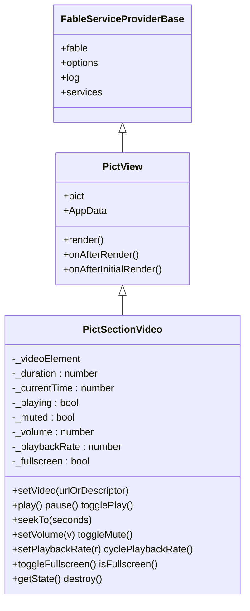
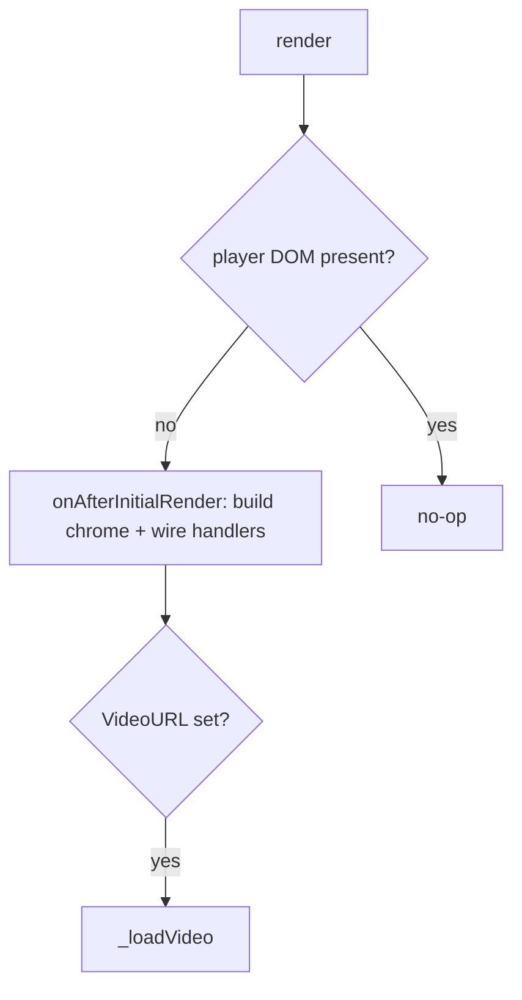
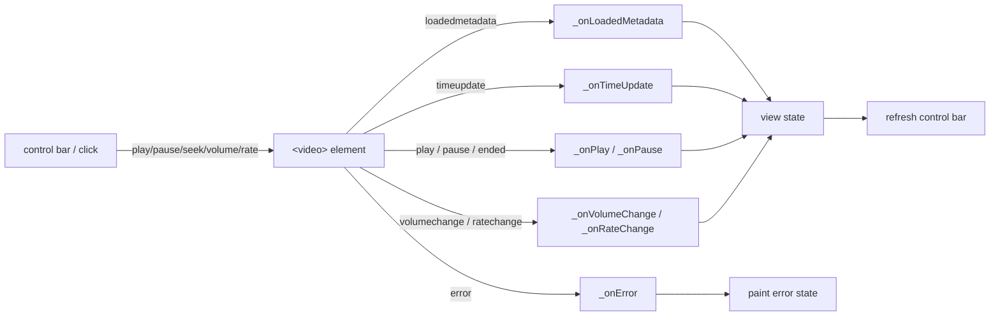

# Architecture

## Overview

`pict-section-video` is a single [`pict-view`](https://fable-retold.github.io/pict-view/) in the lightweight
single-view shape (the same shape as `pict-section-image` / `pict-section-code`): a **stub container template**,
with the player DOM built **imperatively** in `onAfterInitialRender`. A `<video>` is inherently imperative — its
`src`, buffered/seekable ranges, and the `loadedmetadata` / `timeupdate` / `play` / `pause` events have no
template equivalent — so the control bar and the media element are built once as real DOM and wired with
element-property handlers rather than the template engine.

## Class hierarchy

## Build-once, self-heal

The default configuration renders only a stub comment. On the first `onAfterRender`, when the player DOM is not
present, `onAfterInitialRender` builds the real chrome into the target element and grabs references. If a host
re-render ever re-stamps the stub over the built DOM, the next `onAfterRender` detects the missing stage and
rebuilds — instance state (`_url`, `_currentTime`, `_fullscreen`) persists, so the rebuild re-loads the current
video and stays self-healing rather than silently wiping the player.

## The media-event loop

The control bar is a passive reflection of the `<video>` element. User actions call the element's own methods;
the element then fires media events, and the element-property handlers translate those into view state and a
control-bar refresh. This one-way loop keeps the UI and the media in agreement even when playback is driven from
outside the player (autoplay, the OS media keys, another script).

### Event wiring — the programmatic-element exception

The control-bar buttons, the seek/volume `<input>`s, and the `<video>`'s media events use **element-property
handlers** (`el.onclick = …`, `video.ontimeupdate = …`), not `addEventListener` and not template inline handlers.
The pict rule against `addEventListener` is about listeners silently lost when the template engine re-renders a
view; this widget is built once and never re-rendered by the template engine, element-property handlers cannot
duplicate, and the media events have no template-handler equivalent. This is the same exception
`pict-section-code` / `pict-section-image` document.

## Seeking rides native HTTP Range

The player sets `<video src>` and lets the browser own the fetch. When the reader scrubs, the browser issues an
HTTP **Range** request for the bytes around the target time — so a range-served file (an
[`orator-file-service`](https://fable-retold.github.io/orator-file-service/) route, a Sluice depot, a bare 206
URL) seeks instantly without downloading the whole clip. The seek slider maps its `0..1000` position onto
`currentTime`; `_onTimeUpdate` maps `currentTime` back onto the slider, skipping the write while the reader holds
focus so a drag is never clobbered.

## Fullscreen

Fullscreen is a **fill-the-viewport** presentation (a `position: fixed` root via the `.psv-fullscreen` class),
not the native Fullscreen API — so it is testable headless and consistent with `pict-section-image`. A
document-level `Escape` handler is installed only while maximized and removed on exit and on `destroy` (the
documented pict exception for a browser-level event with no element-level inline equivalent).

## Teardown

`destroy()` pauses the element, nulls every element-property handler, removes the `src`, detaches the `Escape`
handler, clears the target, and drops all DOM references — so the player leaves no observers or document listeners
behind.
