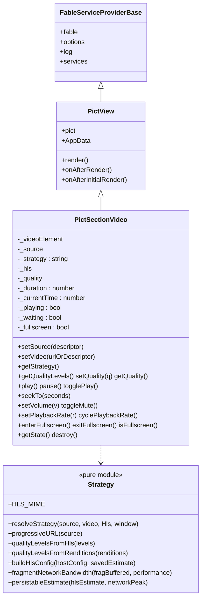
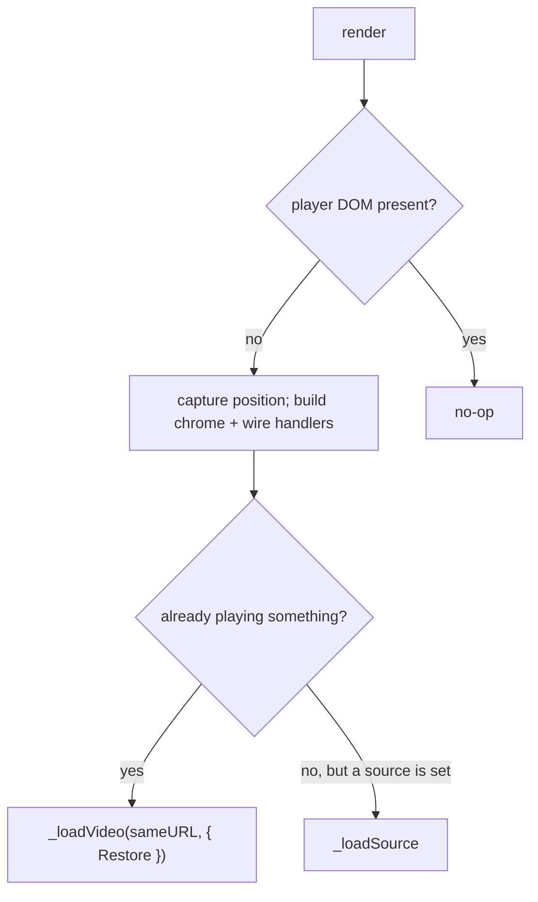
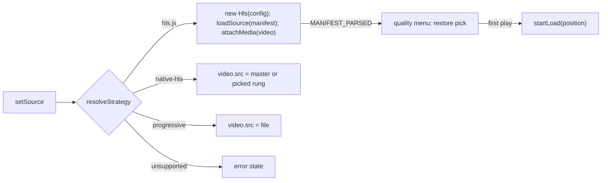
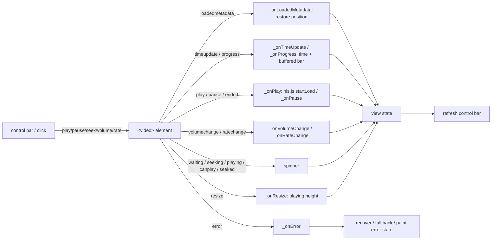

# Architecture

## Overview

`pict-section-video` is a single [`pict-view`](https://fable-retold.github.io/pict-view/) in the lightweight
single-view shape (the same shape as `pict-section-image` / `pict-section-code`): a **stub container template**,
with the player DOM built **imperatively** in `onAfterInitialRender`. A `<video>` is inherently imperative — its
`src`, buffered/seekable ranges, and the `loadedmetadata` / `timeupdate` / `play` / `pause` events have no
template equivalent — so the control bar and the media element are built once as real DOM and wired with
element-property handlers rather than the template engine.

A source is either a plain file (progressive) or an adaptive HLS stream (`Stream: { Type:'hls', … }`). For a
stream the player picks native HLS (Safari), a host-supplied hls.js (everywhere else), or the progressive
fallback, and adds a quality menu; see [Adaptive streaming](streaming.md) for the behaviour and this page for how
it is built.

## Class hierarchy

The playback-path decision and the quality-ladder arithmetic live in `Pict-Section-Video-Strategy.js`, a pure
module (no DOM, timers or storage) so the whole decision table is unit-tested without a browser. hls.js is never
required: the host supplies the class (config `HlsLibrary`, else `window.Hls`).

## Build-once, self-heal

The default configuration renders only a stub comment. On the first `onAfterRender`, when the player DOM is not
present, `onAfterInitialRender` builds the real chrome into the target element and grabs references. If a host
re-render ever re-stamps the stub over the built DOM, the next `onAfterRender` detects the missing stage and
rebuilds — instance state (`_source`, `_strategy`, `_currentTime`, `_fullscreen`) persists. The rebuild captures
the reader's position and play state from the outgoing `<video>`, silences it (pause, handlers nulled, `src`
dropped, hls.js destroyed), and reloads exactly what was playing with that position restored — so a re-render
neither wipes the player nor restarts the clip.

## Loading: strategy, then `_loadVideo`

`setSource()` normalizes the descriptor and calls `_loadSource()`, which asks the strategy module for a path and
hands `_loadVideo(pURL, { PreservePosition })` the URL to play: the manifest (hls.js), the master or the picked
rung's playlist (native HLS), or the progressive file. `_loadVideo` attaches hls.js or sets `src`.

With `PreservePosition` (a native rung switch, a fallback step, a self-heal) it captures `{ Time, Paused }` first,
keeps showing that time, and restores both in `_onLoadedMetadata` — the seek happens before the first frame
plays, so the reader never hears the clip restart. While the restore is pending:

- the readout, the scrubber and `getState().CurrentTime` hold the captured time (the `timeupdate` the load
  algorithm queues at `0` is ignored) and the known duration holds until the new metadata replaces it;
- a `play()` / `pause()` (or a `pause` event from playback the player saw start, e.g. the OS media keys) updates
  the restore's `Paused`, so a reader who pauses during the reload stays paused when the metadata arrives.

## hls.js events

hls.js reports through its own listener API (`hls.on(...)`, the documented third-party-library exception):

| Event | Player |
|---|---|
| `MANIFEST_PARSED` | Apply a remembered pick; start loading if a play is already waiting (or `AutoPlay` / `Preload:'auto'`); show the quality button. |
| `LEVEL_SWITCHED` | `PlayingHeight` = the level's short side; the Auto label follows. |
| `FRAG_BUFFERED` | Reset the network-retry budget. A fragment measured over the network (not an HTTP-cache or loopback hit) raises the session's network peak and saves hls.js's estimate held to that peak. |
| `ERROR` | The error mapping (revoked → message; network → retry ×3; media → `recoverMediaError` once; else the fallback ladder). |

Each handler ignores a torn-down instance, and `destroy()` / a new source call `hls.destroy()`.

## The media-event loop

The control bar is a passive reflection of the `<video>` element. User actions call the element's own methods;
the element then fires media events, and the element-property handlers translate those into view state and a
control-bar refresh. This one-way loop keeps the UI and the media in agreement even when playback is driven from
outside the player (autoplay, the OS media keys, another script).

**Buffering.** `waiting` and `seeking` raise a spinner over the stage (it fades in after a short delay, so a seek
into buffered media never flashes it); `playing`, `canplay` and `seeked` lower it. `progress` / `timeupdate` size
a buffered bar under the seek track from the `buffered` range that contains the playhead — `getState().Buffered`
is that range's end, `Waiting` the spinner state.

**Volume on iOS.** iOS ignores scripted `volume` writes; the build probes one write and hides the slider where it
does not stick (mute still works).

### Event wiring — the programmatic-element exception

The control-bar buttons, the seek/volume `<input>`s, the quality menu (button, popover and items) and the
`<video>`'s media events use **element-property handlers** (`el.onclick = …`, `el.onkeydown = …`,
`video.ontimeupdate = …`), not `addEventListener` and not template inline handlers. The pict rule against
`addEventListener` is about listeners silently lost when the template engine re-renders a view; this widget is
built once and never re-rendered by the template engine, element-property handlers cannot duplicate, and the media
events have no template-handler equivalent. This is the same exception `pict-section-code` /
`pict-section-image` document.

The remaining `addEventListener` calls are the documented browser-level exceptions, each installed only while
needed and removed on exit and on `destroy`:

| Listener | Target | Lives while |
|---|---|---|
| `keydown` (Escape) | `document` | the CSS maximize is active |
| `fullscreenchange` / `webkitfullscreenchange` | `document` | real (Fullscreen API) fullscreen is active, or a request is still in flight after an exit |
| `pointerdown` (outside click) | `document` | the quality menu is open |
| `webkitendfullscreen` | our `<video>` (no `on…` property exists) | the iPhone native player is up |
| `hls.on(…)` | the hls.js instance | the instance is attached |

## Seeking rides native HTTP Range

The player sets `<video src>` and lets the browser own the fetch. When the reader scrubs, the browser issues an
HTTP **Range** request for the bytes around the target time — so a range-served file (an
[`orator-file-service`](https://fable-retold.github.io/orator-file-service/) route, a Sluice depot, a bare 206
URL) seeks instantly without downloading the whole clip. HLS ladders ride the same mechanism: each rung is one
byte-ranged `media.mp4`, so hls.js and native HLS fetch segments as Range requests too. The seek slider maps its `0..1000` position onto
`currentTime`; `_onTimeUpdate` maps `currentTime` back onto the slider, skipping the write while the reader holds
focus so a drag is never clobbered.

## Fullscreen

`enterFullscreen()` walks a ladder and returns `true` when it acted:

1. **`requestFullscreen()` on the player root** (or `webkitRequestFullscreen`) — desktop browsers, Android, iPad.
   The root keeps its own control bar in fullscreen. A `fullscreenchange` listener keeps `isFullscreen()` honest
   when the reader leaves through the browser (Esc, a swipe, the browser UI); a refused request (no user gesture,
   a sandboxed iframe) drops to the CSS maximize. The request settles asynchronously: an `exitFullscreen()` that
   comes first (a quick second click) has nothing to leave yet, so the player keeps the listener and leaves real
   fullscreen as soon as the request lands (its promise resolves, or — for the prefixed form — its
   `webkitfullscreenchange` arrives). A change that arrives before our request lands is not read as an exit.
2. **`webkitEnterFullscreen()` on the `<video>`** — iPhone, where only the media element can go fullscreen (the
   native player). `webkitendfullscreen` clears the state when it is dismissed.
3. **The CSS maximize** — a `position: fixed` root via the `.psv-fullscreen` class that fills the browser
   viewport; a document-level `Escape` handler (installed only while maximized) restores it.

`pict-section-fileview` delegates its toolbar fullscreen to this method, so a video inside the file viewer goes
truly fullscreen on a phone.

## Teardown

`destroy()` closes the quality menu, leaves real fullscreen, destroys hls.js (saving its bandwidth estimate),
pauses the element, nulls every element-property handler, removes the `src`, detaches every document listener,
clears the target, and drops all DOM references — so the player leaves no observers or document listeners behind.
